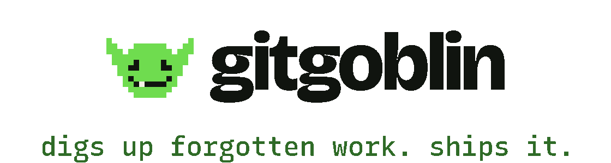

<p align="center">
  <picture>
    <source media="(prefers-color-scheme: dark)" srcset="brand/banner-dark.svg">
    
  </picture>
</p>

# gitgoblin

**Find open-source projects worth your time, work out what they really need, and turn that into a pull request a maintainer would be glad to merge.**

[Website](https://anandkaranubc.github.io/gitgoblin/) · [Getting started](docs/getting-started.md) · [How it works](#how-it-works) · [Contributing](CONTRIBUTING.md)

gitgoblin is a free, open-source companion for contributing to other people's software. It digs through the forgotten corners of public repositories for work that matters, explains why it matters, and helps you do that work to the project's own standards.

> **Status: early development.** There is no release yet. Discovery and repository analysis work from a clone today; preparing a contribution is experimental. See [what works today](#what-works-today).

## Why

Finding somewhere to contribute usually means sorting by stars and searching for "good first issue". That surfaces the same crowded projects everyone else found, and misses the quiet library your own app depends on, the tool whose CI broke last month, and the docs that stopped matching the code two releases ago.

gitgoblin looks for those instead. It ranks projects against what you want, reads a repository the way a careful new maintainer would, and only proposes work it can back with evidence. When it writes code, the project's own tests have to pass, an independent reviewer checks the change, and nothing is published until you say so.

## How it works

1. **Discover.** Search public repositories by goal (contribute, learn, adopt, revive, explore), language, topic, or similarity to a project you already like. Every result comes with the reasons it ranked where it did.
2. **Understand.** Profile a repository: what it is, how it is built and tested, how it treats outside contributors, and which conventions it follows.
3. **Find the work.** Surface concrete, evidence-backed opportunities: issues nobody is working on, CI about to break, docs that contradict the code, dead links, tests missing where the code changes most.
4. **Contribute.** For one opportunity, the engine investigates, plans, implements, runs the project's checks against a baseline, gets an independent review, and prepares a commit and PR description. You read it and decide whether to publish.

## What works today

| Part | Package | Status |
| --- | --- | --- |
| Shared types: repository identity, discovery goals and signals | [packages/core](packages/core) | Working |
| Clients for GitHub and package registries, with a local cache | [packages/sources](packages/sources) | Working |
| Ranking repositories for a goal, with reasons | [packages/discovery](packages/discovery) | Working |
| The `gitgoblin` command: `discover`, `explain`, `goals`, `cache`, `analyze`, `contribute`, `runs`, `show`, `publish` | [packages/cli](packages/cli) | Working from a clone; not published to npm |
| Repository profiling and opportunity discovery (`analyze`) | [packages/intel](packages/intel) | Working from a clone; scores still being calibrated |
| Plan, implement, review, verify, prepare a PR | [packages/engine](packages/engine) | Runs end to end on a test repository; experimental |
| MCP server for Claude Code, Codex, Cursor, Gemini CLI, VS Code and other agents, plus an agent skill | [packages/mcp](packages/mcp) | Released on GitHub (`mcp-v0.1.1`) and listed in the MCP Registry; npm publish pending |

[docs/architecture.md](docs/architecture.md) explains how the parts fit together.

## Try it

You need [Node.js](https://nodejs.org) 24 or newer and git. There is no published package yet, so run it from a clone:

```sh
git clone https://github.com/anandkaranubc/gitgoblin.git
cd gitgoblin
npm install
npx gitgoblin discover contribute --language typescript
```

That prints ten ranked repositories with the reasons behind each ranking. It works without any configuration; a GitHub token unlocks more data and a higher rate limit. [docs/getting-started.md](docs/getting-started.md) walks through the goals, filters, the `explain` command, the token, and analyzing a repository.

## Use it from your AI agent

gitgoblin also runs as an MCP server, so the agent you already use can discover repositories, analyze them and brief you on one piece of work:

```sh
claude mcp add gitgoblin -- npx -y @gitgoblin/mcp     # Claude Code
codex mcp add gitgoblin -- npx -y @gitgoblin/mcp      # Codex
```

[docs/agents.md](docs/agents.md) has the one-liner for Cursor, Gemini CLI, VS Code and every other client, the skill that teaches agents when to use the tools (`npx skills add anandkaranubc/gitgoblin`), and what has been verified. Until the npm package is published, use the tarball URL from the [latest release](https://github.com/anandkaranubc/gitgoblin/releases/tag/mcp-v0.1.1) in place of `@gitgoblin/mcp`; the guide shows it.

## How gitgoblin behaves in other people's projects

Maintainers did not ask for gitgoblin, so it holds itself to three rules:

- **A person approves every external action.** Nothing is pushed, opened, or commented without someone reading it and saying yes, from their own account.
- **The project's rules win.** Contributing guides, templates, rules that ask for an issue before a pull request, contributor license agreements (CLA) and sign-offs (DCO), and "we don't want this kind of change" are read and followed. Projects that do not take outside contributions are left alone.
- **One good contribution beats ten mediocre ones.** Small, tested, evidence-backed changes. No sweeps, no spam.

The full policy, including how maintainers can opt their project out, is in [docs/etiquette.md](docs/etiquette.md).

## Documentation

- [docs/getting-started.md](docs/getting-started.md): install, discover, and read the results
- [docs/agents.md](docs/agents.md): connect gitgoblin to Claude Code, Codex, Cursor, Gemini CLI, VS Code and other agents
- [docs/architecture.md](docs/architecture.md): how the packages fit together and the ideas they share
- [docs/etiquette.md](docs/etiquette.md): how gitgoblin treats the projects it contributes to
- [CONTRIBUTING.md](CONTRIBUTING.md): working on gitgoblin itself
- [SECURITY.md](SECURITY.md): reporting vulnerabilities and the boundaries we defend
- [packages/engine/README.md](packages/engine/README.md): using the contribution engine; its design is in [docs/design.md](packages/engine/docs/design.md)

## Contributing

Bug reports, confusing-documentation reports, and pull requests are all welcome. Start with [CONTRIBUTING.md](CONTRIBUTING.md); it covers setup, how changes are reviewed, and how we feel about AI-assisted contributions (short version: welcome, with you accountable for them). Everyone participating agrees to the [Code of Conduct](CODE_OF_CONDUCT.md).

## License

[MIT](LICENSE).
